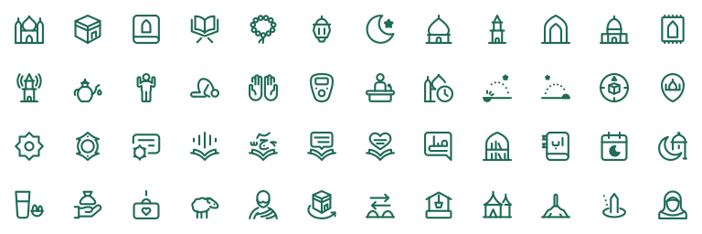

# Islamicons — مكتبة الأيقونات الإسلامية

<picture>
  <source media="(prefers-color-scheme: dark)" srcset=".github/preview-dark.svg">
  
</picture>

[العربية](#العربية) | [English](#english)

<div dir="rtl">

## العربية

أيقونات إسلامية مفتوحة المصدر ومجانية، مرسومة بإتقان على شبكة ٢٤×٢٤ بقواعد رسم واحدة، فتبدو مجموعة واحدة كأنها من يد
واحدة. كل أيقونة ملف SVG عادي يعمل في أي صفحة ويب أو تطبيق.

### الاستعمال

اختر أيقونة من الموقع (يُنشر قريباً)، واضبط حجمها وسُمكها ولونها، ثم انسخ رمز SVG أو نزّله، أو نزّلها صورة PNG. والموقع
بالعربية والإنجليزية.

<div dir="ltr">

```html
<button>
  <svg … stroke="currentColor" overflow="visible" aria-hidden="true">…</svg>
  مواقيت الصلاة
</button>
```

</div>

- **اللون:** تأخذ الأيقونة لون النص حولها (`currentColor`)، فيكفي أن تلوّن العنصر الذي يحتويها.
- **الحافة:** أبقِ `overflow="visible"` في الرمز المنسوخ، فحافة الخط تبلغ حدود اللوحة، وبدونها يقصّ المتصفح جزءاً منها.
- **إمكانية الوصول:** أضف `aria-hidden="true"` إن كان بجوار الأيقونة نص يقول معناها، وإلا فأعطها `role="img"`
  و`aria-label`.

### الحزم

حزمتا `@islamicons/svelte` و`@islamicons/react` قيد الإعداد، وكل أيقونة فيهما مكوّن يحمل اسمها:

<div dir="ltr">

```svelte
<Mosque size={32} />
```

</div>

### المساهمة

نرحّب بالأيقونات الجديدة والتصحيحات. معايير الرسم وقواعد التسمية وطريقة إضافة أيقونة في
[دليل المساهمة](CONTRIBUTING.md).

### الرخصة

MIT، © 2026 Nureddin Haji. مجانية للاستعمال الشخصي والتجاري، والشرط الوحيد أن يبقى نص الرخصة مع نسخ المكتبة أو أجزاء
كبيرة منها. انظر `LICENSE`.

رموز واجهة الموقع، كالبحث والنسخ والتنزيل، من [Tabler Icons](https://tabler.io/icons) برخصة MIT، © Paweł Kuna، وليست
جزءاً من المكتبة.

</div>

## English

Open-source, free Islamic icons, drawn with care on a 24×24 grid to one set of rules, so they read as one set by one
hand. Every icon is a plain SVG that works in any web page or app.

### Usage

Pick an icon on the site (coming soon), set its size, stroke and colour, then copy or download the SVG, or download it
as a PNG. The site is in Arabic and English.

```html
<button>
  <svg … stroke="currentColor" overflow="visible" aria-hidden="true">…</svg>
  Prayer times
</button>
```

- **Colour:** the icon takes the colour of the text around it (`currentColor`), so colouring its container is enough.
- **Edge:** keep `overflow="visible"` in the copied code. The stroke reaches the box edge, and without it the browser
  clips part of it.
- **Accessibility:** add `aria-hidden="true"` when text beside the icon says what it means; otherwise give it
  `role="img"` and an `aria-label`.

### Packages

`@islamicons/svelte` and `@islamicons/react` are in preparation. Each icon is a component named after it:

```svelte
<Mosque size={32} />
```

### Contributing

New icons and fixes are welcome. The drawing standard, the naming rules and how to add an icon are in
[the contributing guide](CONTRIBUTING.md).

### License

MIT, © 2026 Nureddin Haji. Free for personal and commercial use; keep the license text with copies of the library or
substantial parts of it. See `LICENSE`.

The site's interface glyphs (search, copy, download and the like) are from [Tabler Icons](https://tabler.io/icons), MIT,
© Paweł Kuna; they are not part of the library.
